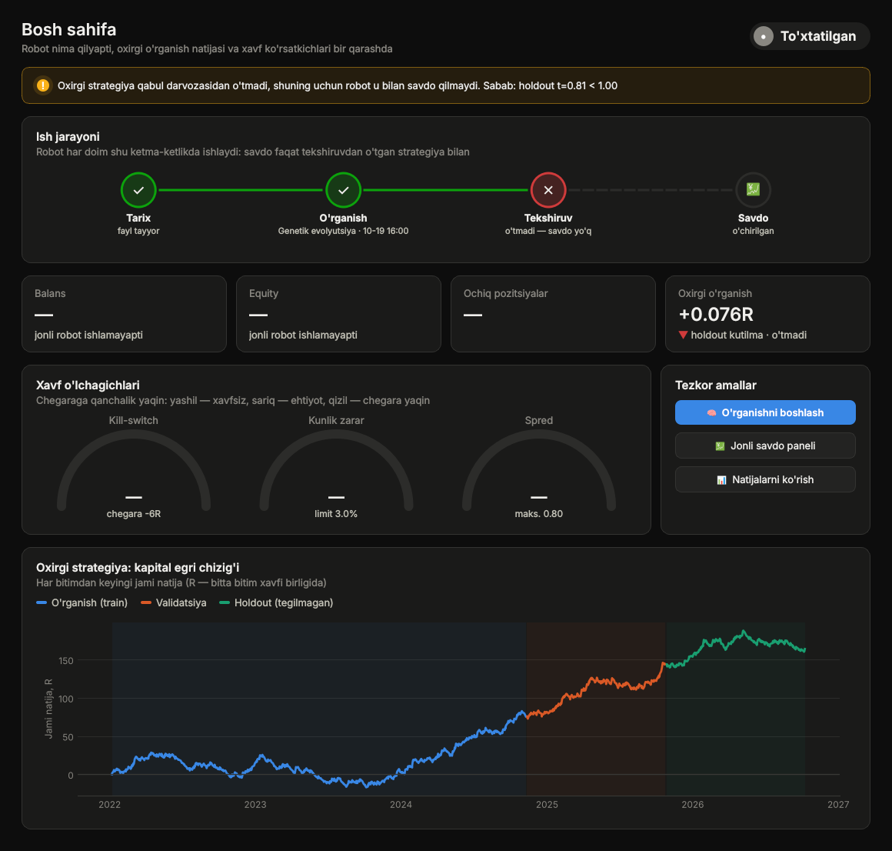
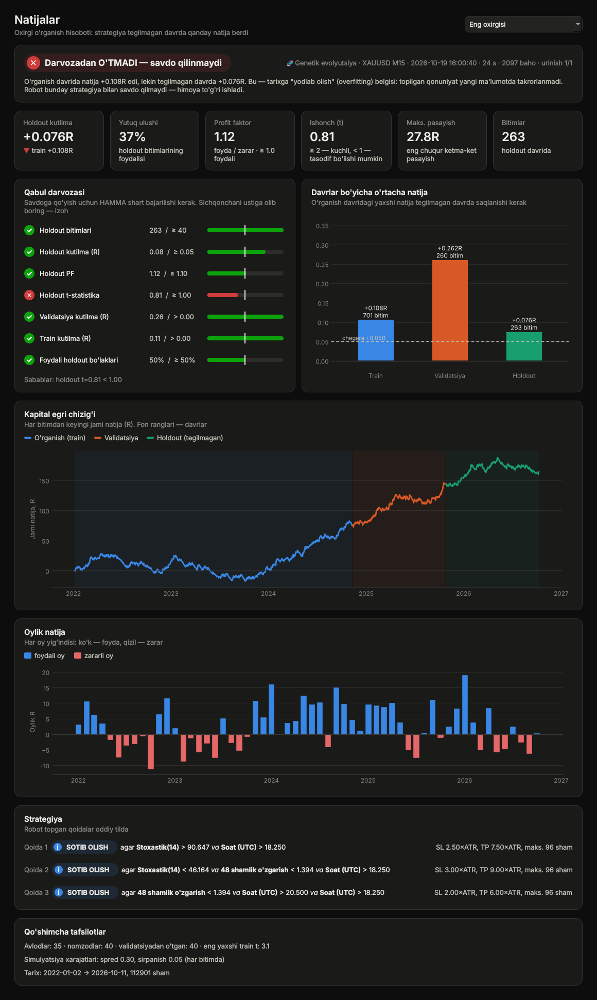

# MyOwnRobot — o'zi o'rganadigan savdo robot (MT5, Python)

Robot tarix faylini (yoki MT5 tarixini) oladi, **o'zi qayta-qayta test qilib** kirish strategiyasini shakllantiradi,
uni **tegilmagan oxirgi davrda** tekshiradi va faqat u yerda foydali chiqsagina DEMO hisobda savdo qiladi.
Har `SL_RELEARN_HOURS` soatda (standart 168 = haftada bir) yangi ma'lumot bilan qayta o'rganadi.

Standart: **XAUUSD, M15**, faqat **DEMO** hisob (`SL_DEMO_ONLY=0` bilan o'chiriladi — tavsiya etilmaydi).

## Uch rejim (`SL_MODE`) — kodda bir-biriga bog'liq emas

| SL_MODE | Fayl | Qanday "o'zi shakllantiradi" |
|---|---|---|
| `genetic` | `sl_genetic.py` | 1–3 shartli kirish qoidalarini (RSI, EMA masofa, Bollinger, yorilish, soat…) evolyutsiya bilan yaratadi; SL/TP/ushlash muddatini ham o'zi tanlaydi |
| `optimizer` | `sl_optimizer.py` | 3 oila (trend_pullback, donchian, bb_revert) parametrlarini walk-forward bilan qayta optimallaydi (18 oy train → 3 oy ko'r test, qo'shni parametrlar bilan silliqlash) |
| `ml` | `sl_ml.py` | XGBoost: har sham uchun "BUY/SELL xarajatlardan keyin TP ga yetadimi" ehtimolini o'rganadi, chegarani validatsiyada tanlaydi, `state/ml_model.joblib` ga saqlaydi |

Har dvigatel faqat `sl_core.py` (tarix, indikator, simulyator, MT5 qatlami) dan foydalanadi, boshqa dvigatelni import qilmaydi
(testlar tekshiradi). `selflearn_robot.py` faqat tanlangan rejimning modulini yuklaydi.

## Haddan tashqari moslashishdan himoya
* Tarix vaqt bo'yicha **train 60% / validatsiya 20% / holdout 20%** (oxirgi, eng yangi). Holdout qidiruvda ishtirok etmaydi.
* Simulyator xarajatlarni hisoblaydi: spred (`SL_SPREAD`, 0.30$), sirpanish (0.05$); signal sham yopilishida, kirish keyingi ochilishda; SL va TP bir shamda tegsa — SL.
* **Qabul darvozasi**: holdout'da kamida 40 bitim, kutilma ≥ +0.05R, PF ≥ 1.10, t ≥ 1.0, validatsiya va train foydali, holdout choraklarining ≥ 50% foydali. O'tmasa robot **savdo qilmaydi** (`SL_REQUIRE_PASS=0` faqat tadqiqot uchun).
* Jonli himoya: oxirgi 20 bitim yig'indisi ≤ −6R bo'lsa to'xtab qayta o'rganadi; kunlik zarar limiti; keng spredda kirmaydi; risk % bo'yicha lot.

## Uzluksiz o'rganish (`--forever`, ilovada «♾ Uzluksiz»)
* Robot darvozadan o'tguncha (yoki to'xtatilguncha) qayta-qayta o'rganadi; har urinish **yangi seed va variant** bilan
  (ML: boshqa SL/TP/ushlash muddati va XGBoost parametrlari; genetic/optimizer: boshqa qidiruv yo'li).
* Urinishlar shu ma'lumot (rejim, simvol, TF, xarajatlar, tarix boshi) uchun `state/attempts.json` da hisoblanadi —
  tugmani qayta bosish yoki ilovani qayta ochish hisobni davom ettiradi, natija takrorlanmaydi.
* Darvozaning t-chegarasi jami urinishlar soniga qarab Bonferroni bo'yicha oshadi (1: 1.00, 10: 2.15, 50: 2.73) —
  yuzlab urinishda tasodifan "o'tib ketgan" strategiya savdoga chiqmasligi uchun.
* Urinishlar hisobi kaliti: rejim, simvol, TF, tarix boshi va oxirgi shamning haftasi (spred kalitga kirmaydi).

### Jonli savdoda to'xtamaydigan o'rganish (`SL_LIVE_CONTINUOUS=1`, standart)
* **Ma'lumot saqlanadi:** har yangi yopilgan sham `state/bars_<SIMVOL>_<TF>.csv` ga qo'shiladi (ishga tushganda MT5 dagi
  60 000 sham ham), o'rganish fayl + ombor + MT5 ni birlashtiradi — tarix vaqt o'tishi bilan o'sadi. Yopilgan jonli
  bitimlar `state/live_trades.csv` ga, har shamdagi haqiqiy spred `live_state.json` ga yoziladi.
* **O'rganish to'xtamaydi:** sikl tugagach `SL_LEARN_PAUSE_SEC` (300 s) pauza va yangi ma'lumot bilan keyingisi.
* **Chempion / raqib:** tekshirilgan strategiya `SL_RELEARN_HOURS` dan yosh bo'lsa, yangi model uning holdout t sidan yuqori
  natija ko'rsatgandagina almashtiriladi (aks holda saqlanmaydi ham). Muddat o'tgach joriy strategiya yangi ma'lumotda
  qaytadan sinovdan o'tishi kerak.
* **Haqiqiy xarajat:** jonli kuzatilgan spred (median) sozlamadagidan katta bo'lsa, o'rganish shuni hisobga oladi.
* Strategiya bo'lmasa (yoki kill-switch ishlasa) savdo qilinmaydi, o'rganish esa davom etadi. To'xtatish: `state/stop.flag`.

## Qayta-qayta o'rganish va tasdiqlash (`--repeat`, `--confirm`)
* `--repeat N` (yoki `SL_REPEAT=N`): robot yangi `seed` bilan N marta qayta o'rganadi, birinchi o'tgan urinishda to'xtaydi.
  Urinish ko'p bo'lsa tasodifan "o'tib ketish" ehtimoli oshadi, shuning uchun holdout `t` chegarasi **Bonferroni bo'yicha qattiqlashadi**
  (1 urinish: t ≥ 1.0, 5 urinish: ≥ 1.86, 10 urinish: ≥ 2.1). Jonli rejimda ham `SL_REPEAT` ishlaydi.
* `--confirm "fayl|spred|sirpanish;fayl2|spred2"` (yoki `SL_CONFIRM`): nomzod strategiya **boshqa instrumentlarda** (masalan XAGUSD, EURUSD M15 tarixi)
  ham foydali bo'lishi kerak (kamida yarmida, har birida ≥20 bitim, kutilma > 0). Xususiyatlar ATR ga nisbatan, shuning uchun instrumentga bog'liq emas;
  xarajat har instrument uchun alohida beriladi. Haqiqiy qonuniyat hamma joyda ishlaydi, tasodif ishlamaydi.
  ```
  python selflearn_robot.py --learn --mode genetic --history data/XAUUSD_M15.csv --repeat 5 ^
     --confirm "data/XAGUSD_M15.csv|0.03|0.01;data/EURUSD_M15.csv|0.00012|0.00003"
  ```
* Real XAUUSD M15 da `--repeat 5` (optimizer) va `--repeat 4` (genetic) ham darvozadan o'tmadi — takrorlash tasodifiy "foyda"ni o'tkazib yubormadi.
* Eng ishonchli tekshiruv — yangi strategiyani demo hisobda 1–2 oy kichik riskda ishlatib ko'rish (tarixga tegmaydigan yagona sinov).

## Haqiqiy tarixdagi natija (XAUUSD M15, 2022-01 … 2026-10, ~113 ming sham) — halol hisobot
Uchala rejim ham o'rganish davrida chiroyli ko'rinadi, lekin tegilmagan davrda ustunlik yo'q — darvoza hammasini rad etdi:

| Rejim | Train (o'rganilgan) | Holdout / OOS | Darvoza |
|---|---|---|---|
| genetic | +0.27R, t=3.7 | +0.03R, t=0.3 | o'tmadi |
| optimizer | +0.14R (oxirgi oyna) | +0.03R, t=0.5 (13 oyna, 552 bitim) | o'tmadi |
| ml | win 65%, +0.41R | −0.01R, t=−0.1 | o'tmadi |

Ya'ni oltin M15 da spred+sirpanishdan keyin bu usullar o'zi hech narsa "ixtiro qila olmadi" — bu normal va aynan shu uchun
himoya bor. Boshqa tarix (boshqa instrument/TF), ko'proq xususiyat, `SL_SPREAD` ni kamaytirish (ECN hisob) bilan sinab ko'ring.
Foyda kafolati yo'q; robot faqat demo uchun.

## O'rnatish
1. `python -m venv .venv_bot && .venv_bot\Scripts\pip install -r requirements.txt` (Python 3.12). Keyin `run_desktop.bat` — grafik ilova.
2. Oflayn tadqiqot (MT5 kerak emas):
   ```
   python selflearn_robot.py --learn --mode genetic   --history data/XAUUSD_M15.csv
   python selflearn_robot.py --learn --mode optimizer --history data/XAUUSD_M15.csv
   python selflearn_robot.py --learn --mode ml        --history data/XAUUSD_M15.csv
   ```
   Natija `state/` papkasida (`learn_log.jsonl`, strategiya fayli). `--budget 600` — ko'proq vaqt, `--force` — o'tmasa ham saqlash (tadqiqot).
3. Jonli (MT5 terminali ochiq, demo hisobga kirilgan): `set SL_MODE=optimizer` va `python selflearn_robot.py`.
   *Robot No.1* dasturida: Jonli → Python robotlar → skript `selflearn_robot.py` + qo'shimcha fayllar `sl_*.py` (+ ixtiyoriy tarix CSV),
   sozlamalarga `SL_MODE=genetic` va `SL_HISTORY=XAUUSD_M15.csv`.
4. Boshqa tarix fayli: `python make_history.py kirish.pkl|csv chiqish.csv M15` (MT4 eksporti, epoch, pkl, parquet o'qiladi;
   fayl vaqti serverda bo'lsa `SL_HISTORY_GMT=2`).

## Qaysi MT5 terminali ishlatiladi?
Robotning o'z terminali yo'q. Mustaqil ishga tushirilganda bir nechta terminal ochiq bo'lsa, MT5 kutubxonasi o'zi tanlaydi — noto'g'ri hisobga ulanishi mumkin. Aniq ko'rsating:
```
set SL_TERMINAL=E:\Program files\MetaTrader 5\terminal64.exe
set SL_LOGIN=114043214
```
`SL_LOGIN` bilan birga `SL_PASSWORD` va `SL_SERVER` berilsa robot **o'zi hisobga kiradi** (ilovada: Jonli → Hisob maydonlari). Parolsiz `SL_LOGIN` — faqat tekshiruv: ulangan hisob boshqa bo'lsa robot to'xtaydi. Portable terminal (papka ichida `portable` rejimida) uchun `SL_PORTABLE=1` (yo'l berilganda standart yoqilgan).
Robot No.1 orqali ishga tushirilsa bu sozlamalar kerak emas — dastur har slotning terminalini o'zi beradi.

## Sozlamalar (env)
`SL_MODE`, `SL_HISTORY`, `SL_HISTORY_GMT`, `SL_HISTORY_YEARS`, `SL_TF`, `SL_RISK_PCT` (0.5), `SL_SPREAD` (0.30), `SL_SLIPPAGE` (0.05),
`SL_MAX_SPREAD` (0.80), `SL_MAX_POS` (1), `SL_MAGIC`, `SL_RELEARN_HOURS` (168), `SL_BUDGET_SEC` (240), `SL_REQUIRE_PASS` (1),
`SL_DEMO_ONLY` (1), `SL_SEED`, `SL_MAX_DAILY_LOSS_PCT` (3), `SL_KILL_WINDOW`/`SL_KILL_SUM_R`, darvoza: `SL_MIN_TEST_TRADES`,
`SL_MIN_EXP_R`, `SL_MIN_PF`, `SL_MIN_T`, `SL_MIN_POS_CHUNKS`; `SL_TERMINAL`, `SL_LOGIN`, `SL_PORTABLE`, `SL_REPEAT`, `SL_TRIALS`, `SL_CONFIRM`; `SL_OPT_SAMPLES`; ML: `SL_ML_SL`, `SL_ML_RR`, `SL_ML_HOLD`.
Telegram: `TELEGRAM_ENABLED`, `TG_BOT_TOKEN`, `TG_CHAT_ID` (Robot No.1 o'zi beradi).

## Desktop ilova (Windows / Linux / macOS)

Robotni buyruq satrisiz boshqarish uchun grafik ilova: `python desktop_app.py` (Windows'da `run_desktop.bat`).
Tayyor `.exe`: GitHub Actions → *Windows build* → `MyOwnRobot_Windows.zip` (yoki `v*` tegidagi reliz).

| Bosh sahifa | Natijalar |
|---|---|
|  |  |

Sahifalar:
* **Bosh sahifa** — robot holati, *Tarix → O'rganish → Tekshiruv → Savdo* zanjiri, balans/equity, xavf o'lchagichlari
  (kill-switch, kunlik zarar, spred) va oxirgi strategiyaning kapital egri chizig'i.
* **O'rganish** — 3 qadam: rejim kartasi, tarix fayli (narx grafigida train/validatsiya/holdout zonalari), vaqt va urinishlar.
  Jarayon jonli: progress, qolgan vaqt, avlodlar/oynalar bo'yicha baho grafigi, jurnal.
* **Natijalar** — "O'TDI / O'TMADI" xulosasi oddiy tilda, 6 ta KPI, darvozaning har bir sharti (qiymat va chegara),
  davrlar bo'yicha o'rtacha natija, kapital egri chizig'i, oylik natija, topilgan qoidalar o'qiladigan ko'rinishda.
* **Jonli savdo** — MT5 terminali/hisob, risk, ▶/■; balans, kunlik natija, ochiq pozitsiyalar, jonli bitimlar R grafigi, jurnal.
* **Jurnal** — barcha o'rganish sikllari (grafik + jadval), **Sozlamalar** — barcha `SL_*` parametrlar izohlari bilan,
  yorug'/qorong'i mavzu, **Yordam** — atamalar va infografika.

Ilova robot kodini o'zgartirmaydi: robot alohida jarayonda ishlaydi, ilova uning `@@PROGRESS` qatorlarini
(`SL_PROGRESS=1`) va `state/` dagi fayllarni o'qiydi: `report_<rejim>.json` (to'liq hisobot: egri chiziqlar, darvoza shartlari),
`live_status.json` (jonli holat, har 3 s), `learn_log.jsonl`. To'xtatish tugmasi `state/stop.flag` yozadi — robot holatni
saqlab chiqadi. Sozlamalar `desktop_settings.json` da.

### Yangilanish tizimi
O'rnatilgan dastur o'zi yangilanadi (Sozlamalar → Yangilanish; manba — GitHub Releases yoki tarmoq papkasi, yopiq repo uchun
faqat o'qish huquqli token):
* ilova ochilganda va har 6 soatda fonda `update.json` tekshiriladi;
* **kod yangilanishi** (kichik zip, ilova + robot kodi) so'ramasdan yuklanadi va SHA-256 bilan tekshiriladi — menyuda
  "Qayta ochish" chiqadi; qayta ochilmasa ham keyingi ishga tushishda kuchga kiradi;
* `requirements.txt`, `build.spec` yoki `desktop_app.py` o'zgargan bo'lsa (`libs` belgisi) — **to'liq paket** so'raladi;
  dastur yopilgach PowerShell skript papkani almashtirib, qayta ochadi;
* yangi kod ishga tushmasa u `BROKEN` deb belgilanadi va oldingi versiya ishlatiladi; yangilangandan keyin "Nima yangi" oynasi.

Reliz: `sl_desktop/__init__.py` dagi `__version__` ni oshiring va `main` ga birlashtiring — `v<versiya>` tegi hali bo'lmasa CI
`.exe`, `update.json` va `myownrobot_app-<versiya>.zip` ni GitHub Release'ga avtomatik joylaydi (`[release]` yoki `v*` teg ham ishlaydi). Qo'lda:
`python tools/release.py publish OUTDIR --full MyOwnRobot_Windows.zip`.

## Testlar
`python -m pytest tests -q` (simulyator qo'lda yozilgan etalon bilan mos, lookahead yo'qligi, yashirin qonuniyatni genetik topishi,
soxta MT5 bilan lot/buyurtma, dvigatellar mustaqilligi).
